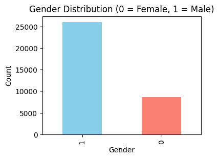
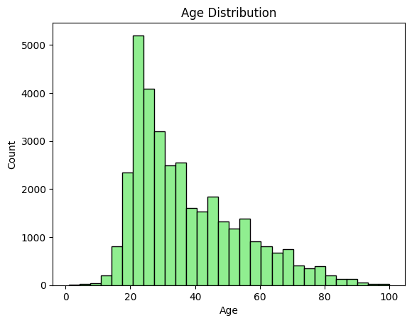

# Face Age & Gender Prediction

A multi-task deep learning model that predicts a person's **age** (regression) and **gender** (binary classification) from a single face image, built in PyTorch.

Built for a Kaggle competition in the *Deep Learning & Generative AI* course of the IIT Madras BS in Data Science programme (Nov 2025).

## Problem

| | |
|---|---|
| Input | RGB face image, resized to 224×224 |
| Outputs | Age (continuous) and gender (0/1) from the **same network** |
| Train / test | 34,708 / 8,677 images (80/20 train/validation split) |
| Metrics | Age MAE, gender accuracy |

<p align="center">
  
  
</p>

## Approach

Both models share one design: **a shared feature extractor with two task-specific heads**, trained jointly with a combined loss:

```
loss = MSE(age) + λ · BCEWithLogits(gender)      (λ = 1.0)
```

```
image ──► backbone ──► shared features ─┬─► age head    ──► age (regression)
                                        └─► gender head ──► gender logit
```

### 1. CNN from scratch
4 convolutional blocks (Conv → BatchNorm → ReLU → MaxPool, 32 → 256 channels), then a shared 512-unit dense layer with dropout and two separate heads. 26.2M trainable parameters.

### 2. Fine-tuned ResNet-18
An ImageNet-pretrained ResNet-18 backbone with its classifier removed, plus two new heads (128 units each, dropout 0.3). 8.5M trainable parameters.

**Data pipeline**: a custom `Dataset` that enforces 3 channels, ImageNet normalisation, and random horizontal flip plus ±10° rotation for augmentation.

**Experiment tracking**: [Trackio](https://huggingface.co/docs/trackio), logged to a Hugging Face Space, with best-checkpoint saving on validation loss. Trained weights were uploaded to **KaggleHub**, and the inference section loads them from there instead of retraining.

## Results (validation set)

| Model | Age MAE ↓ | Gender accuracy ↑ | Params |
|---|---|---|---|
| CNN from scratch (10 epochs) | 7.69 years | 80.7% | 26.2M |
| **ResNet-18 fine-tuned (15 epochs)** | **6.60 years** | **91.0%** | 8.5M |

Transfer learning cut the age error by ~14% and raised gender accuracy by ~10 points, using a third of the parameters.

## Key takeaways

- **Pretrained features matter a lot on faces.** ImageNet features transfer well even though ImageNet isn't a face dataset.
- **Multi-task learning is efficient.** One backbone serves both tasks, so it costs much less than training two separate networks.
- **Most of the scratch model's parameters are in one layer.** The flatten → dense layer (256·14·14 → 512) holds about 25M of the 26.2M parameters. Global average pooling would shrink it dramatically.

## Repository structure

```
.
├── notebooks/
│   └── face_age_gender_prediction.ipynb   # data → models → training → inference
├── assets/
└── README.md
```

## Running it

The competition data can't be redistributed. The notebook was built to run on Kaggle (GPU), and data paths point to `/kaggle/input/...`.

```bash
pip install torch torchvision torchmetrics pandas matplotlib trackio kagglehub
```
